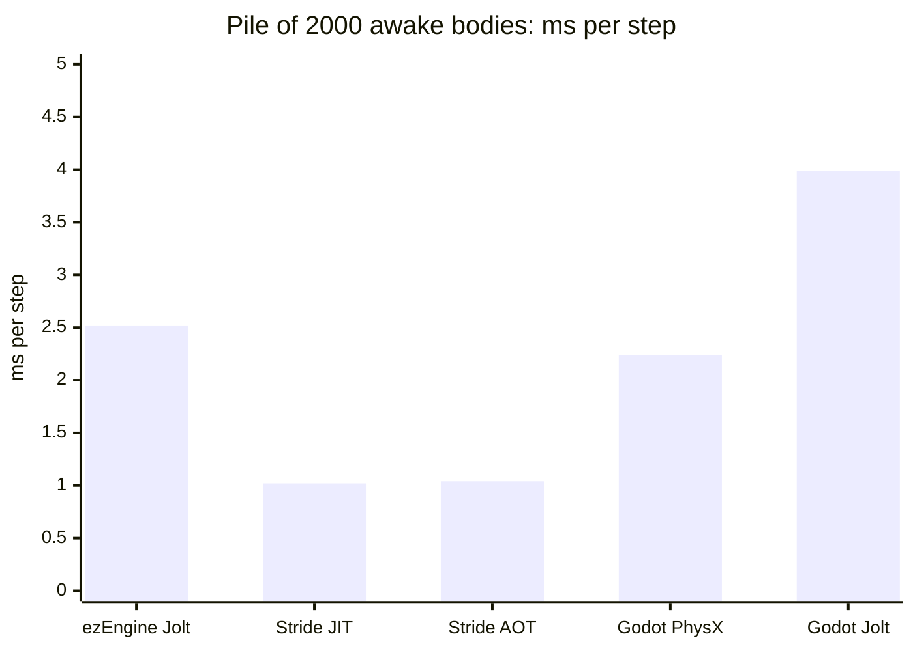
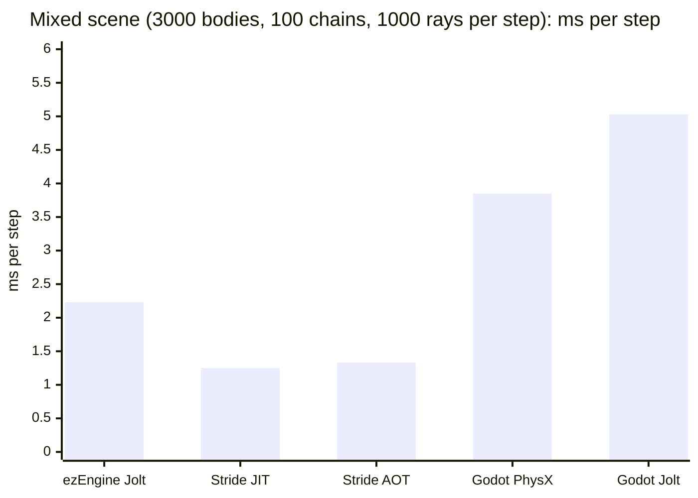
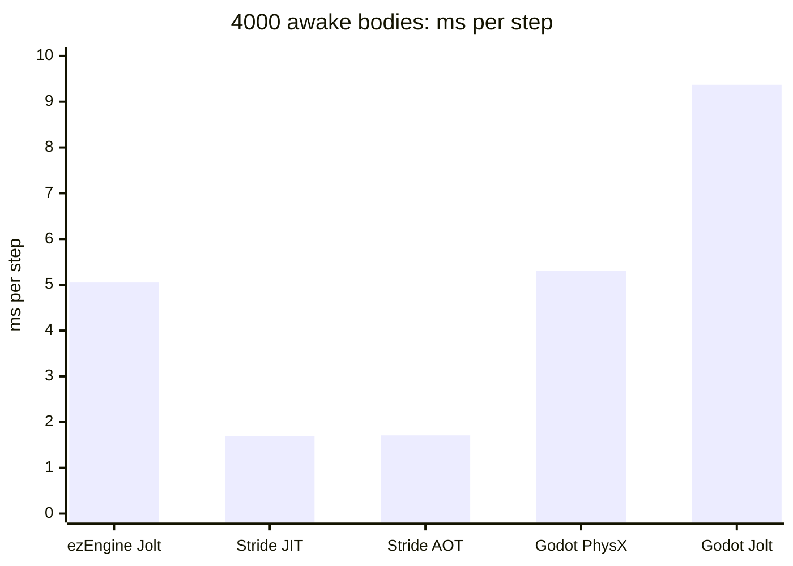
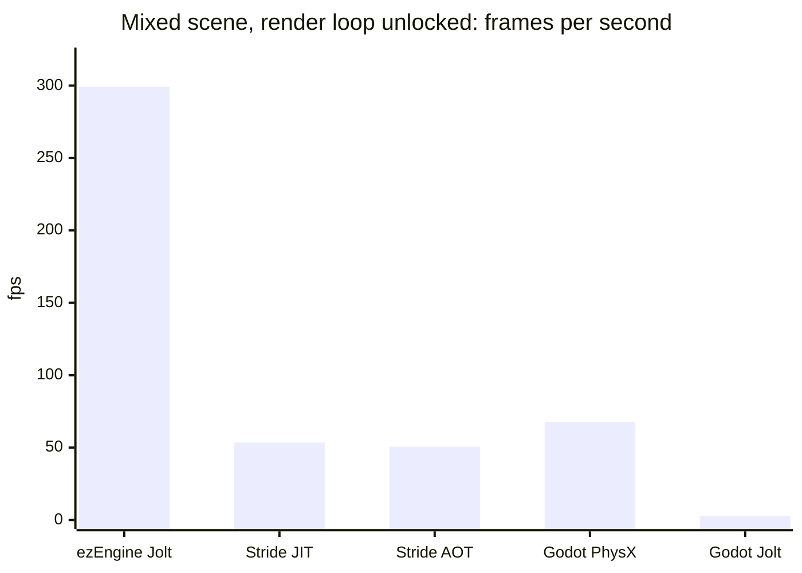
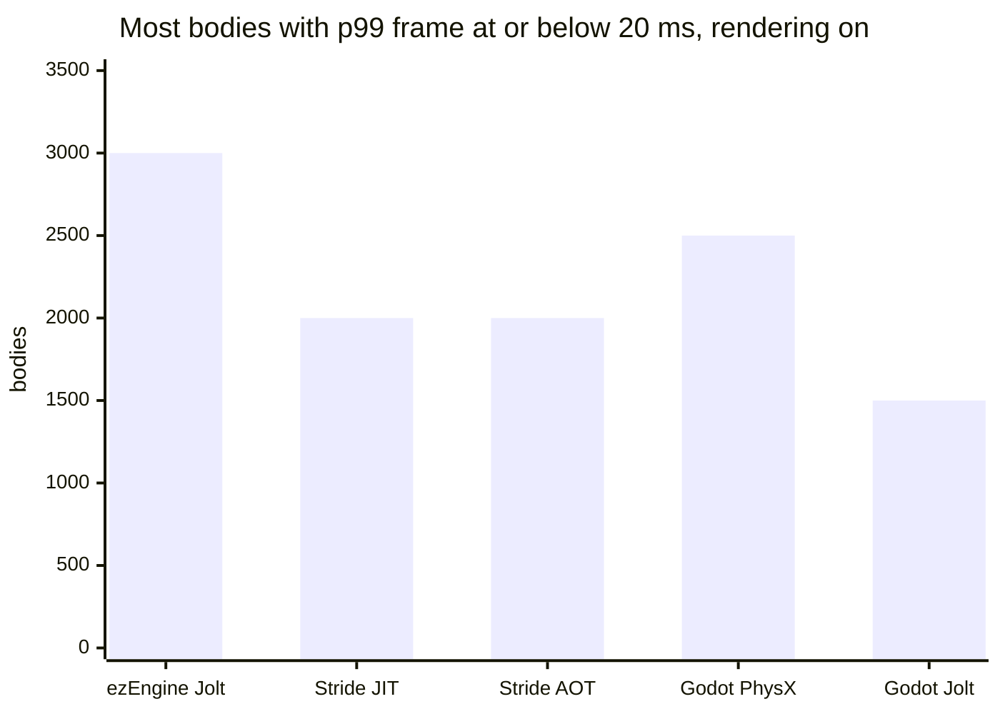
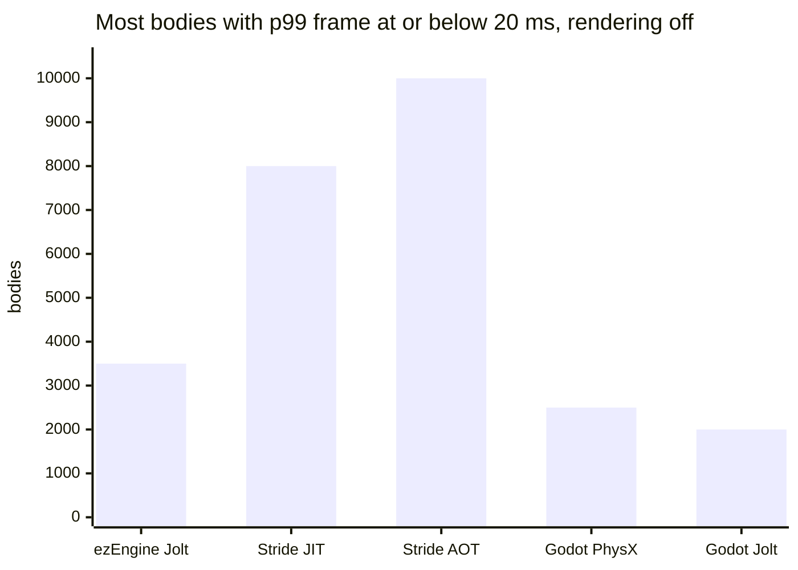

# QuestMark

Game engines benchmark and engine study for Quest, a planned physics-heavy 3D game (target 60 fps on a handheld PC, Windows-only build run via Proton on Linux handhelds).

- [benchmark/README.md](benchmark/README.md): the benchmark (Godot with Jolt or a PhysX fork, Stride with Bepu, ezEngine with Jolt). [benchmark/SPEC.md](benchmark/SPEC.md) is the single source of truth for scenarios, settings and pass rules.
- [docs/engine-choice.md](docs/engine-choice.md): engine study, full benchmark results and the verdict (section 12.2).
- [benchmark/results/SUMMARY.md](benchmark/results/SUMMARY.md): old 60 Hz results from the first Godot and Stride runs. They are not comparable with the 200 Hz results below. Raw run output stays local.
- [AGENTS.md](AGENTS.md): instructions for AI agents working in this repo.

## Benchmark summary (2026-11-08)

**Verdict, provisional until a Steam Deck run: 1 ezEngine + Jolt, 2 Stride + Bepu, 3 Godot + Jolt.**

- **ezEngine** is the only engine that keeps the game-like mixed scene well inside the frame budget with rendering on.
- **Stride** has by far the cheapest physics, but its frame gets expensive once it renders.
- **Godot + Jolt** is the slowest engine in every test. The same Jolt costs 1.6 to 2.4 times more per step in Godot than in ezEngine.

The setup and analysis are in [docs/engine-choice.md](docs/engine-choice.md), section 12.2.

Every run uses fixed 200 Hz physics, which leaves a 5 ms budget per step. All numbers come from the `stress` profile, where sleeping is off and every body stays awake. Engine labels:

| Label | Engine and physics | Build |
|---|---|---|
| ezEngine Jolt | ezEngine with Jolt | Shipping, D3D11 |
| Stride JIT | Stride 4.4.1 with Bepu | Release, JIT |
| Stride AOT | Stride 4.4.1 with Bepu | Release, Native AOT |
| Godot PhysX | Godot PhysX fork | CPU-only |
| Godot Jolt | Godot 4.7.2 with Jolt | Release export |

### Physics cost per step (lower is better)

Each value is the wall time per physics step with rendering off and the loop unpaced: 1000 / steps per second.

### Whole frame with rendering (higher is better)

### Physics-only capacity (higher is better)

### The numbers

| Measure (stress profile) | ezEngine Jolt | Stride JIT | Stride AOT | Godot PhysX | Godot Jolt |
|---|---|---|---|---|---|
| Pile, 2000 bodies: ms per step | 2.52 | 1.02 | 1.04 | 2.24 | 3.99 |
| Mixed scene: ms per step | 2.23 | 1.25 | 1.33 | 3.85 | 5.03 |
| 1000 / 2000 / 4000 bodies: ms per step | 1.06 / 2.50 / 5.05 | 0.59 / 1.02 / 1.69 | 0.62 / 1.04 / 1.71 | 1.17 / 2.36 / 5.30 | 1.85 / 4.07 / 9.37 |
| Mixed scene with rendering: p99 frame ms | 5.1 | 25.0 | 25.0 | 89.5 | 408 |
| Mixed scene, render loop unlocked: fps | 299 | 54 | 51 | 68 | 2.8 |
| Most bodies at 20 ms, rendering on / off | 3000 / 3500 | 2000 / 8000 | 2000 / 10000 | 2500 / 2500 | 1500 / 2000 |

With sleeping on (`game` profile), the 2000-body pile falls asleep in Bepu (0.09 ms per step) and in PhysX (0.23 ms per step). With default settings it stays awake under Jolt in both Godot and ezEngine. The benchmark reports sleeping as engine behaviour and does not force it equal.

### Limits

- **Hardware:** one desktop machine and no Steam Deck run. On the Deck, ezEngine and Stride go through DXVK while Godot's Vulkan goes straight through (winevulkan), so desktop ratios may not carry over.
- **Run dates:**
  - Stride and the Godot PhysX values in the charts: 2026-11-07 run, PhysX fork build c6f3b659. That build ran jointed bodies with the fork default of 1/1 solver iterations, so its mixed-scene numbers are optimistic.
  - Godot Jolt and ezEngine: 2026-11-08 run.
- **Repeats:** each value with rendering off and the mixed-scene values are medians of 3 runs. Each step of the body-count ladders (the "most bodies at 20 ms" values) ran once, so those values are uncertain by about one stage.
- **Engine differences:**
  - Godot and ezEngine ship different Jolt versions.
  - Bepu has no restitution, and its solver settings are not the same quantity as Jolt's.
  - Stride renders 4 shadow cascades, which differs from the others.
  - The full parity table is in [benchmark/SPEC.md](benchmark/SPEC.md).
- **Godot setup:** Godot was tested with one `RigidBody3D` node per body. Bodies created directly in the physics server with MultiMesh drawing were not tested.

License: see [LICENSE](LICENSE).
