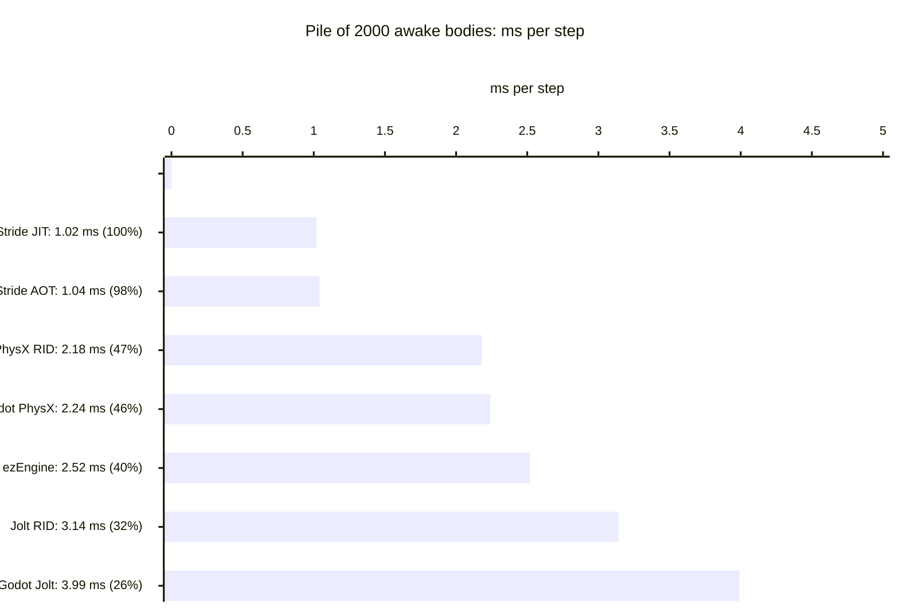
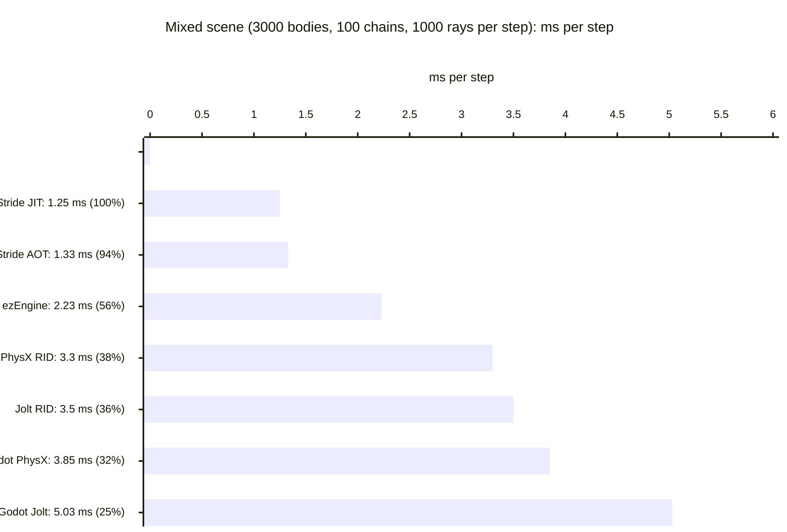
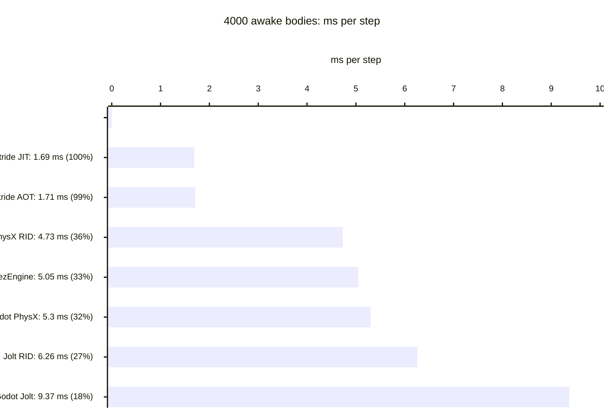
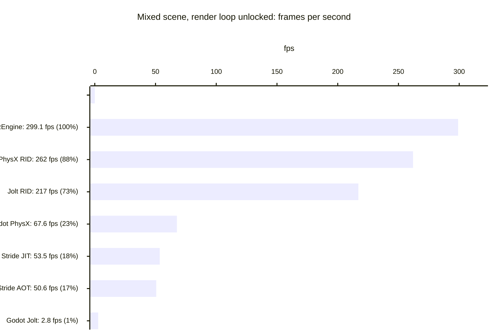
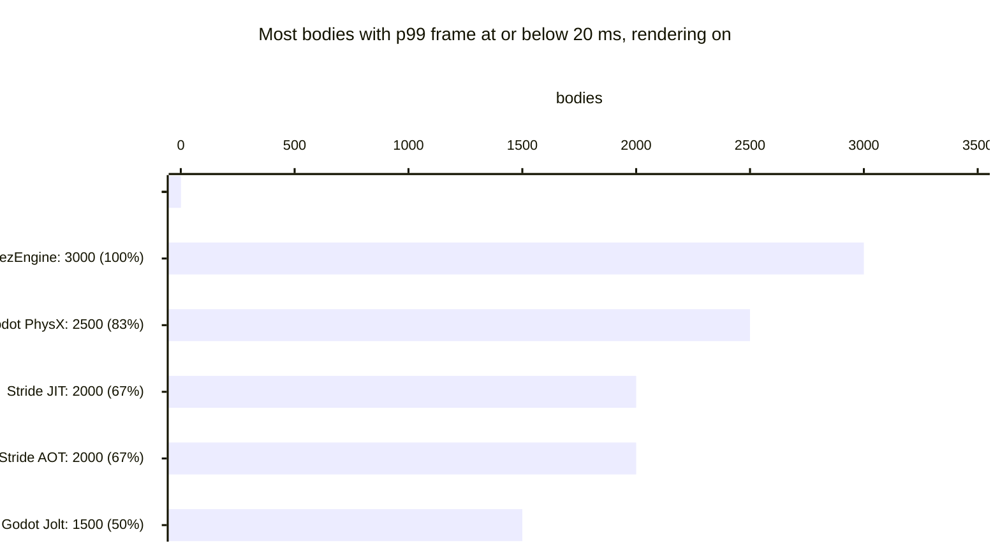
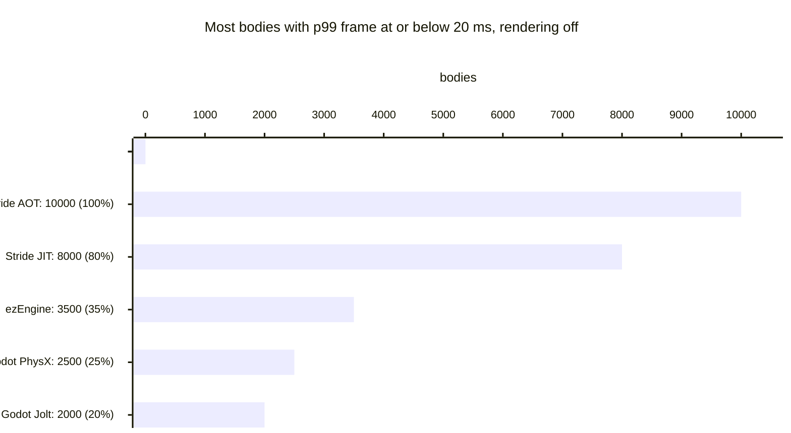

# QuestMark

Game engines benchmark and engine study for Quest, a planned physics-heavy 3D game (target 60 fps on a handheld PC, Windows-only build run via Proton on Linux handhelds).

- [benchmark/README.md](benchmark/README.md): the benchmark (Godot with Jolt or a PhysX fork, Stride with Bepu, ezEngine with Jolt). [benchmark/SPEC.md](benchmark/SPEC.md) is the single source of truth for scenarios, settings and pass rules.
- [docs/engine-choice.md](docs/engine-choice.md): engine study, full benchmark results and the verdict (section 12.2).
- [benchmark/results/SUMMARY.md](benchmark/results/SUMMARY.md): old 60 Hz results from the first Godot and Stride runs. They are not comparable with the 200 Hz results below. Raw run output stays local.
- [AGENTS.md](AGENTS.md): instructions for AI agents working in this repo.

## Quick start (Windows 10/11 x64)

Double-click `QuestMark.bat`, or run `bash benchmark/tools/run-benchmark.sh` from Git for Windows. It downloads what is missing, compiles, runs and prints a summary. Close every other program first: timings are only valid on an idle machine, and the benchmark windows must stay visible.

1. **Prerequisites** (the script checks them first, changes nothing, and prints one numbered install line per missing item): Git for Windows, CMake 3.21 or newer, Visual Studio 2022 or Build Tools with the "Desktop development with C++" workload and a Windows SDK, Python 3, the .NET 10 SDK (for Stride), and 30 GB of free disk (ezEngine alone needs about 20 GB). LLVM clang-cl is used for the Godot extension when it is on PATH, otherwise MSVC.
2. **Setup** (`bash benchmark/tools/setup.sh [godot] [stride] [ezengine]`, also run by the launcher): downloads the pinned sources and tools into `.tmp/` (nothing is installed system-wide), builds the Godot extension, exports Godot, builds Stride and ezEngine. Finished steps are skipped on the next run, so an interrupted setup resumes. Logs are in `.tmp/logs/`. The first run takes roughly 1 to 1.5 hours (estimate from the script's own step times, mostly the ezEngine build; the Godot part measured about 15 min with clang).
3. **Run:** `--quick` (default, about 25 min for all three engines) runs a subset of cells for a first impression and is not the SPEC protocol. `--full` runs the SPEC protocol (about 1 h per engine variant). Useful flags: `godot stride ezengine` (pick engines), `--rid` (add the Godot RID variant), `--runs N`, `--no-setup`, `--summary-only`, `--dry`.
4. **Results:** `.tmp/results/SUMMARY.md` plus per-run CSV, summary and env files. The script also prints the ms-per-step headline, fps and p99 for the rendered cells, and the physics class each Godot run actually used.
5. **Optional, Godot PhysX fork:** `bash benchmark/tools/setup-physx.sh` builds the PhysX SDK and the fork. It needs a lot of time and disk and was only tested up to its dry run and skip logic.

Known deviations from the published numbers: setup uses the standard (non-mono) Godot 4.7.2 build, the published numbers used the mono build; the ezEngine setup path (fresh clone, Shipping build, asset transform) has not been run end to end yet.

## Benchmark summary (2026-11-08)

**Verdict, provisional until a Steam Deck run: 1 ezEngine + Jolt, 2 Stride + Bepu, 3 Godot (PhysX fork ahead of Jolt on the measured numbers; the final order is your decision).**

- **ezEngine** is the only engine that keeps the game-like mixed scene well inside the frame budget with rendering on.
- **Stride** has by far the cheapest physics, but its frame gets expensive once it renders.
- **Node-based Godot + Jolt** is the slowest engine in every test. The same Jolt costs 1.6 to 2.4 times more per step in Godot than in ezEngine.
- **Godot on RIDs + MultiMesh** changes the whole-frame picture. In the mixed scene with rendering, Godot Jolt goes from 2.8 to 217 fps and Godot PhysX from about 73 to 262 fps, which beats Stride (54 and 51 fps); ezEngine stays ahead at 299. Per physics step Stride is still cheapest (pile 1.02 ms against 3.14 ms for Godot Jolt RID). The ranking above was made with node-based Godot and is not changed here: the final order is the user's decision.

The setup and analysis are in [docs/engine-choice.md](docs/engine-choice.md), sections 12.2 and 12.3.

Every run uses fixed 200 Hz physics, which leaves a 5 ms budget per step. All numbers come from the `stress` profile, where sleeping is off and every body stays awake. Engine labels:

| Label | Engine and physics | Build |
|---|---|---|
| ezEngine Jolt | ezEngine with Jolt | Shipping, D3D11 |
| Stride JIT | Stride 4.4.1 with Bepu | Release, JIT |
| Stride AOT | Stride 4.4.1 with Bepu | Release, Native AOT |
| Godot PhysX | Godot PhysX fork | CPU-only |
| Godot Jolt | Godot 4.7.2 with Jolt | Release export |
| Godot Jolt RID | Godot 4.7.2 with Jolt, bodies made on `PhysicsServer3D`, MultiMesh drawing | Release export |
| Godot PhysX RID | Godot PhysX fork, bodies made on `PhysicsServer3D`, MultiMesh drawing | CPU-only |

"Godot Jolt" and "Godot PhysX" without RID are the node-based variants (one `RigidBody3D` and one `MeshInstance3D` per body).  In the charts the RID variants are labelled "Jolt RID" and "PhysX RID", and "ezEngine" stands for ezEngine Jolt.

### Physics cost per step (lower is better)

Each value is the wall time per physics step with rendering off and the loop unpaced: 1000 / steps per second. Bars run best to worst; the percentage is the best value divided by this value (best = 100%, 50% means twice as slow).

### Whole frame with rendering (higher is better)

Best to worst; the percentage is this value divided by the best value.

### Physics-only capacity (higher is better)

### The numbers

| Measure (stress profile) | ezEngine Jolt | Stride JIT | Stride AOT | Godot PhysX | Godot Jolt | Godot PhysX RID | Godot Jolt RID |
|---|---|---|---|---|---|---|---|
| Pile, 2000 bodies: ms per step | 2.52 | 1.02 | 1.04 | 2.24 | 3.99 | 2.18 | 3.14 |
| Mixed scene: ms per step | 2.23 | 1.25 | 1.33 | 3.85 | 5.03 | 3.30 | 3.50 |
| 1000 / 2000 / 4000 bodies: ms per step | 1.06 / 2.50 / 5.05 | 0.59 / 1.02 / 1.69 | 0.62 / 1.04 / 1.71 | 1.17 / 2.36 / 5.30 | 1.85 / 4.07 / 9.37 | 1.145 / 2.26 / 4.73 | 1.51 / 3.15 / 6.26 |
| Mixed scene with rendering: p99 frame ms | 5.1 | 25.0 | 25.0 | 89.5 | 408 | 5.6 | 5.6 |
| Mixed scene, render loop unlocked: fps | 299 | 54 | 51 | 68 | 2.8 | 262 | 217 |
| Most bodies at 20 ms, rendering on / off | 3000 / 3500 | 2000 / 8000 | 2000 / 10000 | 2500 / 2500 | 1500 / 2000 | not measured | not measured |

The two RID columns are from the body API test of 2026-11-08 (3 runs per cell, one desktop, stress profile). The Godot PhysX RID values come from the fork build at 97bc4de; the PhysX node values in the table are from the older build c6f3b659, so compare PhysX nodes and RID in [docs/engine-choice.md](docs/engine-choice.md) section 12.3, which has same-build node values (for example 4000 bodies: 6.12 ms nodes against 4.73 ms RID).

With sleeping on (`game` profile), the 2000-body pile falls asleep in Bepu (0.09 ms per step) and in PhysX (0.23 ms per step). With default settings it stays awake under Jolt in both Godot and ezEngine. The benchmark reports sleeping as engine behaviour and does not force it equal.

### Limits

- **Hardware:** one desktop machine and no Steam Deck run. On the Deck, ezEngine and Stride go through DXVK while Godot's Vulkan goes straight through (winevulkan), so desktop ratios may not carry over.
- **Run dates:**
  - Stride and the Godot PhysX values in the charts: 2026-11-07 run, PhysX fork build c6f3b659. That build ran jointed bodies with the fork default of 1/1 solver iterations, so its mixed-scene numbers are optimistic.
  - Godot Jolt and ezEngine: 2026-11-08 run.
  - Godot Jolt RID and Godot PhysX RID: body API test of 2026-11-08 (PhysX at fork head 97bc4de).
- **Repeats:** each value with rendering off and the mixed-scene values are medians of 3 runs. Each step of the body-count ladders (the "most bodies at 20 ms" values) ran once, so those values are uncertain by about one stage.
- **Engine differences:**
  - Godot and ezEngine ship different Jolt versions.
  - Bepu has no restitution, and its solver settings are not the same quantity as Jolt's.
  - Stride renders 4 shadow cascades, which differs from the others.
  - The full parity table is in [benchmark/SPEC.md](benchmark/SPEC.md).
- **Godot setup:** the node-based rows use one `RigidBody3D` node per body. The RID rows create bodies directly in the physics server and draw them with MultiMesh (one desktop, stress profile, 3 runs per cell). That needs a game design that drives the physics server directly, it is not a settings switch. Debris (scenario G), the body-count capacity ladders and the sleeping profile were not run in RID mode, and chain behaviour of the RID chains was not compared with the node chains. A function-level Jolt profile does not exist, so why Jolt pays more than the PhysX fork on nodes in the mixed render scene is a hypothesis.

License: see [LICENSE](LICENSE).
