# QuestMark

Game engines benchmark and engine study for Quest, a planned physics-heavy 3D game (target 60 fps on a handheld PC, Windows-only build run via Proton on Linux handhelds).

- [benchmark/README.md](benchmark/README.md): the benchmark (Godot with Jolt or a PhysX fork, Stride with Bepu, ezEngine with Jolt). [benchmark/SPEC.md](benchmark/SPEC.md) is the single source of truth for scenarios, settings and pass rules.
- [docs/engine-choice.md](docs/engine-choice.md): engine study, full benchmark results and the verdict (section 12.2).
- [benchmark/results/SUMMARY.md](benchmark/results/SUMMARY.md): old 60 Hz results from the first Godot and Stride runs. They are not comparable with the 200 Hz results below. Raw run output stays local.
- [AGENTS.md](AGENTS.md): instructions for AI agents working in this repo.

## Quick start (Windows 10/11 x64)

Double-click `QuestMark.bat`, or run `bash benchmark/tools/run-benchmark.sh` from Git for Windows. It downloads what is missing, compiles, runs and prints a summary. Close every other program first: timings are only valid on an idle machine, and the benchmark windows must stay visible.

1. **Prerequisites** (the script checks them first, changes nothing, and prints one numbered install line per missing item): Git for Windows, CMake 3.21 or newer, Visual Studio 2022 or Build Tools with the "Desktop development with C++" workload and a Windows SDK, Python 3, the .NET 10 SDK (for Stride), and 30 GB of free disk (ezEngine alone needs about 20 GB). LLVM clang-cl is used for the Godot extension when it is on PATH, otherwise MSVC.
2. **Setup** (`bash benchmark/tools/setup.sh [godot] [stride] [ezengine]`, also run by the launcher): downloads the pinned sources and tools into `.tmp/` (nothing is installed system-wide), builds the Godot extension, exports Godot, builds Stride and ezEngine. Finished steps are skipped on the next run, so an interrupted setup resumes. Logs are in `.tmp/logs/`. The first run takes roughly 1 to 1.5 hours (estimate from the script's own step times, mostly the ezEngine build; the Godot part measured about 15 min with clang).
3. **Run:** `--quick` (default, about 25 min for all three engines) runs a subset of cells for a first impression and is not the SPEC protocol. `--full` runs the SPEC protocol (about 1 h per engine variant). Useful flags: `godot stride ezengine` (pick engines), `--rid` (add the Godot RID variant), `--runs N`, `--no-setup`, `--summary-only`, `--dry`.
4. **Results:** `.tmp/results/SUMMARY.md` plus per-run CSV, summary and env files. The script also prints the ms-per-step headline, fps and p99 for the rendered cells, and the physics class each Godot run actually used.
5. **Optional, Godot PhysX fork:** `bash benchmark/tools/setup-physx.sh` builds the PhysX SDK and the fork. It needs a lot of time and disk and was only tested up to its dry run and skip logic.

Known deviations from the published numbers: setup uses the standard (non-mono) Godot 4.7.2 build, the published numbers used the mono build; the ezEngine setup path (fresh clone, Shipping build, asset transform) has not been run end to end yet.

## Benchmark summary (2026-11-09)

**Verdict (2026-11-10), provisional until a Steam Deck run: 1 ezEngine + Jolt, 2 Godot + PhysX fork, 3 Stride + Bepu, 4 Godot + Jolt (ranked in play under load; the final order is your decision).**

Update 2026-11-10: the order follows a new rule: a real game scene under load must not drop frames while playing, and a freeze at start-up does not count (it can run behind a loading screen). The rule, data and numbers are in [In play under load](#in-play-under-load-the-verdict-rule). In play (stress profile, frames after the first 5 s) ezEngine holds 60 fps on 100% of frames, the PhysX fork on 95.3%, Stride on 0.4 to 10.3% and Godot Jolt nodes on 0%. This replaces the earlier 2026-11-10 reading (worse-profile whole window, Stride second), which counted the start-up frames. Scorecard and limits: docs/engine-choice.md section 12.2.

Update 2026-11-09 (earlier text; the order is now the one in the bold line above): the order was unchanged then, but ezEngine's lead is narrower. The ranking compares each engine's default usage first (ezEngine: its own Jolt physics components; Godot: nodes; Stride: Bepu), and the deciding measure for a rendered 60 fps game is the frame with rendering. ezEngine is the only engine whose default path keeps the game-like mixed scene well inside the 60 fps budget with rendering (p99 8.6 / 8.9 ms, stress / game, against 19.3 ms or more for every other default path). Per physics step its default path is no longer ahead of Godot PhysX. On per-step physics alone Stride would be first and Godot PhysX ahead of ezEngine. Details and limits: docs/engine-choice.md section 12.2.

- **ezEngine** (default usage, through its own Jolt physics components) is the only engine whose default path keeps the game-like mixed scene well inside the frame budget with rendering on (p99 8.6 / 8.9 ms, stress / game; 222 fps unlocked). Per step it costs 10 to 40 % more than ezEngine direct Jolt (same session) and is level with Godot Jolt on RIDs. **ezEngine direct Jolt** (the alternative path: bodies made and stepped through the Jolt BodyInterface) is 10 to 40 % cheaper per step and has the best rendered frame measured (p99 5.1 / 5.2 ms, 299 fps), so it is a measured fallback for physics hot spots. Capacity with rendering at 20 ms (stress): ezEngine 2500 bodies, direct Jolt 3000 (game profile: 2500 against 2000). Debris with rendering: ezEngine 3.5 events per second, direct Jolt 3 (direct Jolt never tested 3.5, so equal within ladder resolution). Ladders measured 2026-11-10 on the components path (docs/engine-choice.md section 12.6).
- **Stride** has by far the cheapest physics (Bepu 2.3 to 3.8 times below ezEngine, 8000 to 10000 bodies at 20 ms in physics mode), but its frame gets expensive once it renders (about 54 fps in the mixed scene, p99 24 to 39 ms; cause not profiled). In play under load (3) it holds 60 fps on only 10.3% of frames (JIT) and 0.4% (AOT), p99 22.4 and 24.9 ms.
- **Godot + PhysX fork (2)**, through the node path, is 28 % lower per step than ezEngine on the pile (pit-2000 2.24 against 3.10 ms), 18 % lower at 4000 bodies (5.30 against 6.45 ms), 14 % lower at 1000 bodies (1.17 against 1.366 ms) and 20 % higher in the mixed scene (3.85 against 3.22 ms). Against ezEngine direct Jolt it is 21 % lower on the pile (2.82 ms), 3.5 % lower at 4000 bodies (5.49 ms, PhysX single runs, inside run-to-run drift) and level at 1000 bodies (1.158 ms, within about 1 %). ezEngine values measured 2026-11-09 (3 runs, median). It is faster than Godot Jolt in every physics cell. Its pile sleeps with default settings. In the mixed scene with rendering, nodes give p99 19.3 / 89.5 ms (game / stress, whole window). In play under load it holds 60 fps on 95.3% of frames with p99 20.9 ms; the 89.5 ms whole-window p99 is a start-up backlog. Whether a mid-game spike could start a similar recovery is a hypothesis, not measured. It is a single-maintainer fork and our build is CPU-only; those risks were not used for the order, and the final order is your decision.
- **Node-based Godot + Jolt (4)** is the slowest engine in every test. The same Jolt costs 1.2 to 1.6 times more per step in Godot nodes than in ezEngine (default components path), and 1.4 to 2.2 times more than in ezEngine direct Jolt (stress and game profile cells).
- **Sleeping differs by engine design** and is reported, not forced equal: with default settings the Bepu and PhysX piles fall asleep, the Jolt pile stays awake in both Godot and ezEngine.
- **10000 rays per step at 200 Hz** fail real time in every engine (ezEngine 353 ms per frame, direct Jolt 345), so that scene does not separate the candidates. Creating bodies at run time (debris) is about 6 to 10 times dearer in node-based Godot than in ezEngine direct Jolt (the spawn cost was not measured on the default path; the debris ladder was, see the table).
- **Godot on RIDs + MultiMesh** (Godot's alternative path) changes the whole-frame picture. In the mixed scene with rendering, Godot Jolt goes from 2.8 to 217 fps and Godot PhysX from about 73 to 262 fps, which beats Stride (54 and 51 fps); ezEngine runs 222 fps (direct Jolt 299). With RIDs Godot reaches p99 5.5 to 9.2 ms with rendering, which would rank Godot above Stride on the rendered frame; this comparison uses Godot's alternative path, so it does not change the default-usage order. In the debris scenario (game profile, one run per rate) PhysX RID passes 7 events per second with rendering and 8 without (corrected 2026-11-10 from 6 and 8, see Limits), the highest with rendering; Jolt RID passes 3 and 3, the same as ezEngine direct Jolt with rendering and equal to it without. Per physics step Stride is still cheapest (pile 1.02 ms against 3.14 ms for Godot Jolt RID). The ranking above was made with node-based Godot and is not changed here: the final order is the user's decision.

The setup and analysis are in [docs/engine-choice.md](docs/engine-choice.md), sections 12.2 and 12.3.

Every run uses fixed 200 Hz physics, which leaves a 5 ms budget per step. The charts show both profiles (the title says "game" where it is the `game` profile, with default sleeping). The table of numbers below is the `stress` profile, where sleeping is off and every body stays awake. Engine labels:

| Label | Engine and physics | Build | Graphics API (main results) |
|---|---|---|---|
| ezEngine | ezEngine with Jolt, through its own physics components (default usage, `--physics-path=components`) | Shipping | D3D11 (`-renderer DX11`) |
| ezEngine direct Jolt | ezEngine with Jolt, bodies made and stepped through the Jolt BodyInterface by the benchmark (alternative path, `--physics-path=raw`) | Shipping | D3D11 (`-renderer DX11`); the exe also has Vulkan, 0 to 43% lower fps in the [Renderer A/B](#renderer-ab-higher-is-better) section |
| Stride JIT | Stride 4.4.1 with Bepu | Release, JIT | Direct3D11 (`StrideGraphicsApi` in `benchmark/stride/StrideBench.csproj`) |
| Stride AOT | Stride 4.4.1 with Bepu | Release, Native AOT | Direct3D11 (same project) |
| Godot PhysX | Godot PhysX fork | CPU-only | Vulkan (engine default, inferred: these runs predate the driver lines in env.txt) |
| Godot Jolt | Godot 4.7.2 with Jolt | Release export | Vulkan (same inference); D3D12 measured equal in the [Renderer A/B](#renderer-ab-higher-is-better) section |
| Godot Jolt RID | Godot 4.7.2 with Jolt, bodies made on `PhysicsServer3D`, MultiMesh drawing | Release export | Vulkan (same inference) |
| Godot PhysX RID | Godot PhysX fork, bodies made on `PhysicsServer3D`, MultiMesh drawing | CPU-only | Vulkan (same inference) |

RID means resource ID: Godot's opaque handle to an object inside a low-level server such as `PhysicsServer3D` (Godot `doc/classes/RID.xml`). The RID variants create each body with `PhysicsServer3D.body_create()` and keep only that handle, with no scene node per body. "Godot Jolt" and "Godot PhysX" without RID are the node-based variants (one `RigidBody3D` and one `MeshInstance3D` per body).  In the charts the RID variants are labelled "Jolt RID" and "PhysX RID". Naming (user decision 2026-11-09): using ezEngine through its own Jolt physics components is the default way to use the engine and is called "ezEngine"; creating and stepping bodies through the Jolt BodyInterface directly is the alternative and is called "ezEngine direct Jolt". The analogy: Godot's default is nodes, its alternative is RIDs; ezEngine's default is components, its alternative is direct Jolt. Every ezEngine number published before 2026-11-09 evening came from the direct Jolt path.

### In play under load (the verdict rule)

The ranking rule since 2026-11-10: a real game scene under load must not drop frames while playing; a freeze at start-up does not count (it can run behind a loading screen). Data: mixed scene with rendering (3000 bodies, 100 chains, 1000 rays per step), stress profile (all bodies awake), frames after the first 5 s of the 20 s measured window, median of 3 runs, one desktop (no Steam Deck). "At 60 fps" = frames of 16.7 ms or less.

| Variant | p99 frame | median frame | max frame | frames at 60 fps |
|---|---|---|---|---|
| ezEngine (components, default) | 8.45 ms | 4.58 ms | 9.49 ms | 100% |
| ezEngine direct Jolt | 5.08 ms | 3.93 ms | 5.63 ms | 100% |
| Godot PhysX fork (nodes) | 20.89 ms | 10.75 ms | 26.31 ms | 95.3% |
| Stride JIT | 22.44 ms | 18.10 ms | 25.67 ms | 10.3% |
| Stride AOT | 24.94 ms | 19.96 ms | 28.19 ms | 0.4% |
| Godot Jolt (nodes) | 387 ms | 347 ms | 387 ms | 0% |
| Godot PhysX fork (RID, alternative) | 5.58 ms | 4.44 ms | 6.32 ms | 100% |
| Godot Jolt (RID, alternative) | 9.07 ms | 4.82 ms | 10.45 ms | 100% |

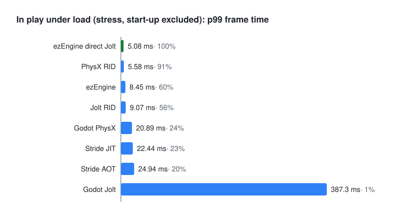

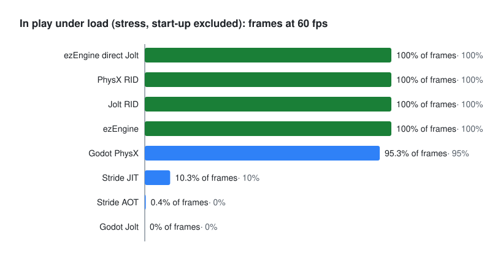

### Physics cost per step (lower is better)

The charts show "ezEngine" (default, components path, slice accounting, 2026-11-09 run) and "ezEngine direct Jolt" (alternative). The capacity and debris charts have both since the 2026-11-10 ladder run on the components path. The capacity and debris charts were regenerated on 2026-11-10 with the corrected ladder rule for all series (docs/engine-choice.md section 13 item 29).

Each value is the wall time per physics step with rendering off and the loop unpaced: 1000 / steps per second. Bars run best to worst (bars at 100% are green); the percentage is the best value divided by this value (best = 100%, 50% means twice as slow).

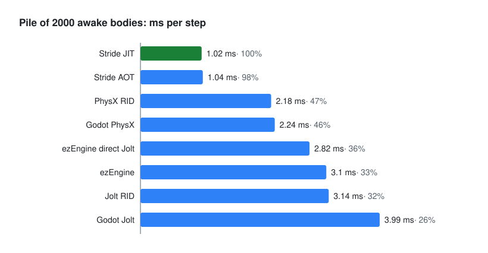

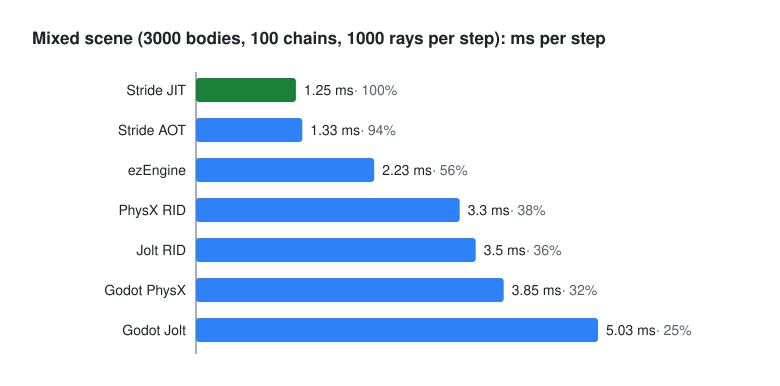

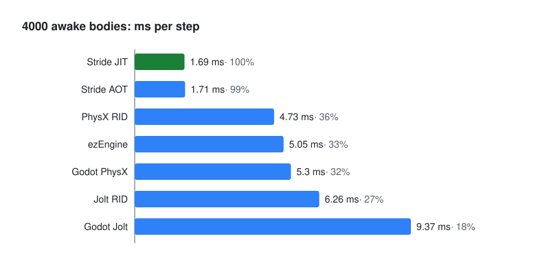

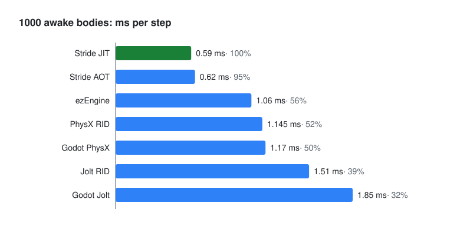

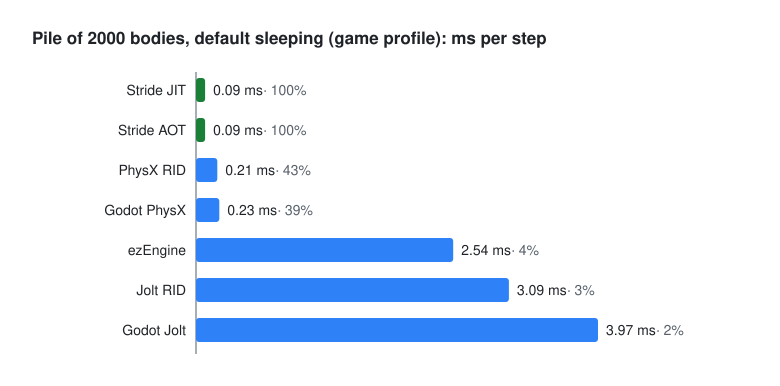

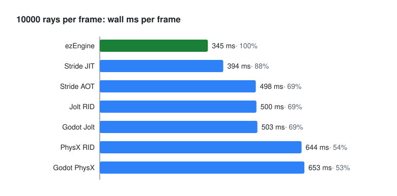

### Frame time with rendering (lower is better)

99th percentile frame time of the mixed scene with rendering on over the whole 20 s measured window, start-up included (the Godot PhysX fork stress value comes from its start-up backlog; in play see the section above); the frame budget is 20 ms.

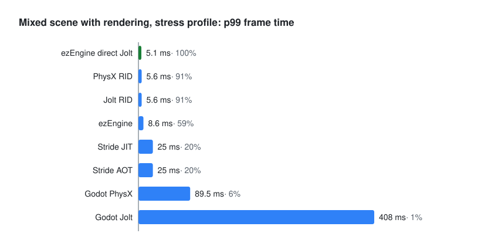

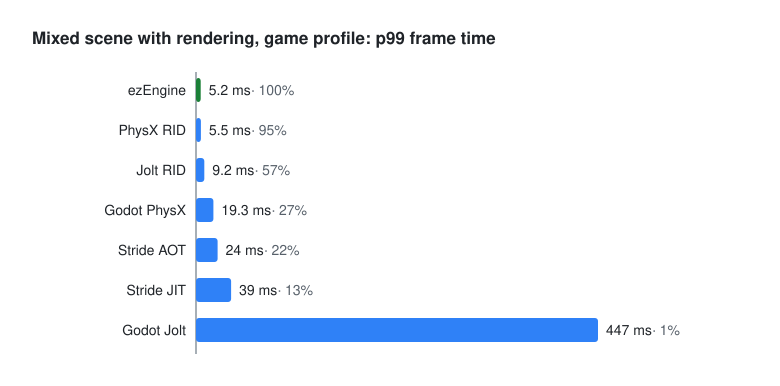

### Whole frame with rendering (higher is better)

Best to worst; the percentage is this value divided by the best value. Charts without game in the title are the stress profile.

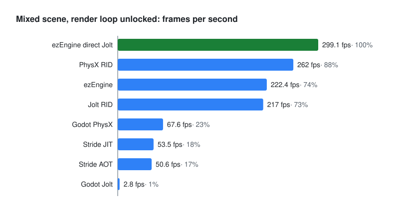

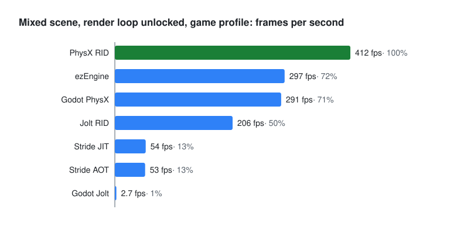

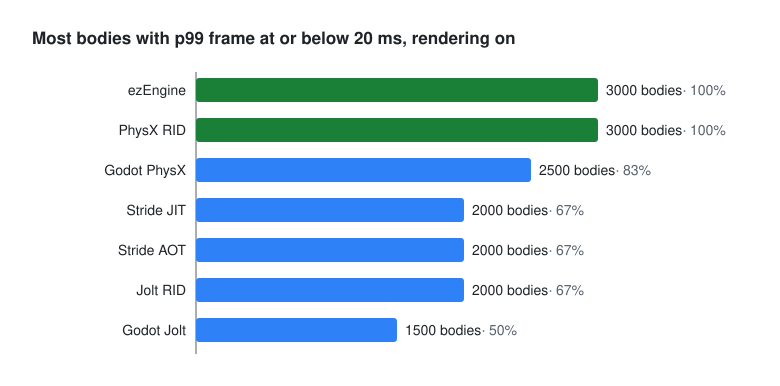

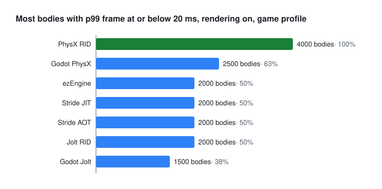

### Physics-only capacity (higher is better)

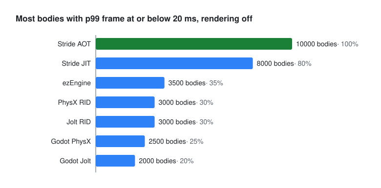

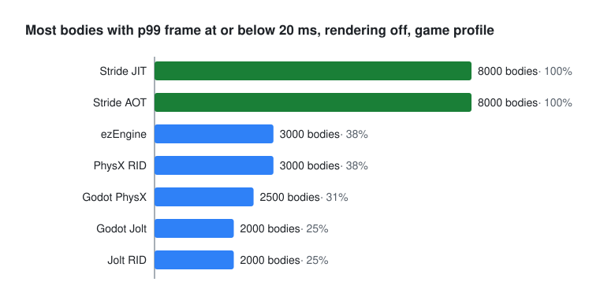

### Debris (higher is better)

Scenario G always runs with default sleeping. The value is the highest debris rate (events per second, 64 pieces per event) that keeps the p99 frame time at or below 20 ms on the tested ladder.

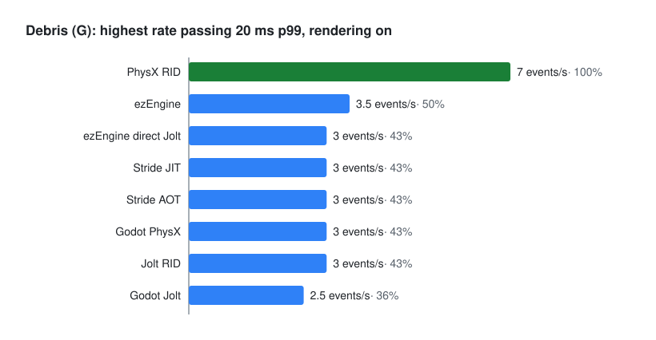

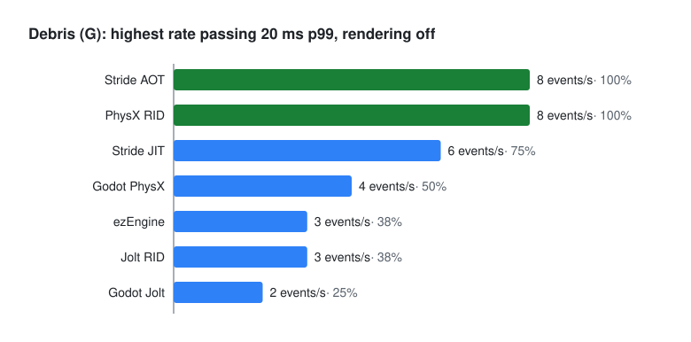

### Renderer A/B (higher is better)

Stages A and D only, median of 3 runs, one desktop, native Windows (no Steam Deck). ezEngine direct Jolt (the A/B ran on the direct Jolt path): the same exe with `-renderer DX11` and `-renderer Vulkan`; Godot: stock Jolt, nodes, `GODOT_RD_DRIVER=vulkan` and `d3d12`. ezEngine Vulkan is slower in every cell; Godot shows no difference beyond the run spread (details: docs/engine-choice.md sections 3.1a and 12.4). Median fps per cell (percentage against the same engine's other renderer):

| Cell | ezEngine direct Jolt DX11 | ezEngine direct Jolt Vulkan | Godot Jolt Vulkan | Godot Jolt D3D12 |
|---|---|---|---|---|
| pile of 2000, physics mode, stress | 1223.6 | 702.1 (-43%) | 144.9 | 144.9 (0%) |
| pile of 2000, physics mode, game | 1178.8 | 728.9 (-38%) | 144.7 | 144.9 (+0.1%) |
| mixed scene, rendering, stress | 288.3 | 259.3 (-10%) | 2.8 | 2.8 (0%) |
| mixed scene, rendering, game | 277.8 | 231.3 (-17%) | 2.8 | 2.8 (0%) |

The Godot physics-mode fps looks pacing-bound (identical on both drivers). These bars compare each engine with its own other renderer; the Godot and ezEngine rows are not one ranking (the main charts above use other cells).

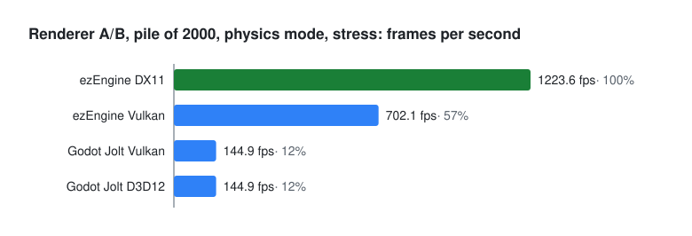

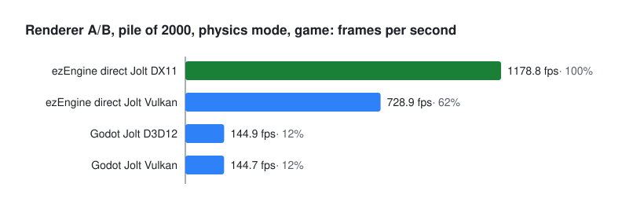

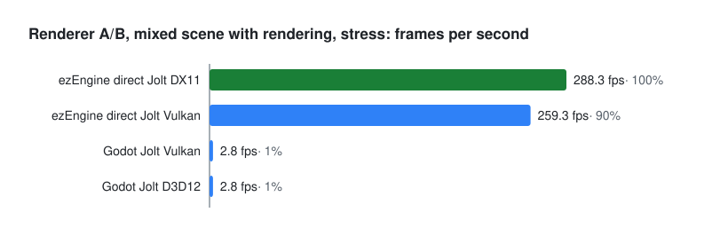

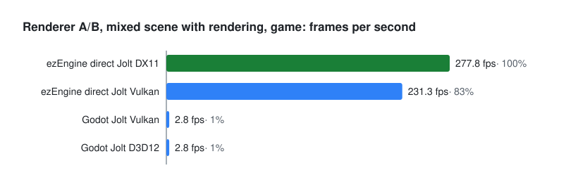

### The numbers

| Measure (stress profile) | ezEngine | ezEngine direct Jolt | Stride JIT | Stride AOT | Godot PhysX | Godot Jolt | Godot PhysX RID | Godot Jolt RID |
|---|---|---|---|---|---|---|---|---|
| Pile, 2000 bodies: ms per step | 3.10 | 2.82 | 1.02 | 1.04 | 2.24 | 3.99 | 2.18 | 3.14 |
| Mixed scene: ms per step | 3.22 | 2.47 | 1.25 | 1.33 | 3.85 | 5.03 | 3.30 | 3.50 |
| 1000 / 2000 / 4000 bodies: ms per step | 1.366 / not measured / 6.45 | 1.158 / 2.68 / 5.49 | 0.59 / 1.02 / 1.69 | 0.62 / 1.04 / 1.71 | 1.17 / 2.36 / 5.30 | 1.85 / 4.07 / 9.37 | 1.145 / 2.26 / 4.73 | 1.51 / 3.15 / 6.26 |
| Mixed scene with rendering: p99 frame ms | 8.6 | 5.1 | 25.0 | 25.0 | 89.5 | 408 | 5.6 to 9.1 | 5.6 |
| Mixed scene, render loop unlocked: fps | 222 | 299 | 54 | 51 | 68 | 2.8 | 262 | 217 |
| Most bodies at 20 ms, rendering on / off | 2500 / 3000 | 3000 / 3500 | 2000 / 8000 | 2000 / 10000 | 2500 / 2500 | 1500 / 2000 | 3000 / 3500 | 2500 / 3000 |
| Debris, game profile: highest rate at 20 ms, rendering on / off | 3.5 / 3.5 | 3 / 3 | 3 / 8 | 3 / 10 | 3 / 5 | 2.5 / 2.5 | 7 / 8 | 3 / 3 |

The ezEngine column is the components path, measured 2026-11-09 (3 runs, median; p99 from stage D, paced); the ezEngine direct Jolt column is the earlier raw-path results (ms per step, 1000 and 4000 bodies and mixed-scene cells re-measured the same session). The two RID columns are from the body API test of 2026-11-08 (3 runs per cell, one desktop, stress profile). A second set of 3 runs (stages A, B, D, E, 2026-11-08, both profiles) reproduced the stress medians within 3 %, except the Jolt RID mixed-scene p99 frame: 5.6 ms in the first set, 9.1 ms in the second (medians equal at 4.8 ms). The p99 jumps because more than 1 % of the frames took two physics steps in the second set (1.6 to 2.3 % against 0.6 to 0.7 %), so it is shown as a range. The Godot PhysX RID values come from the fork build at 97bc4de; the PhysX node values in the table are from the older build c6f3b659, so compare PhysX nodes and RID in [docs/engine-choice.md](docs/engine-choice.md) section 12.3, which has same-build node values (for example 4000 bodies: 6.12 ms nodes against 4.73 ms RID).

With sleeping on (`game` profile), the 2000-body pile falls asleep in Bepu (0.09 ms per step) and in PhysX (0.23 ms per step). With default settings it stays awake under Jolt in both Godot and ezEngine. The benchmark reports sleeping as engine behaviour and does not force it equal. Changing the Jolt sleep threshold changes these results: in an ezEngine test (pit-2000, game profile) 0.03 m/s (default) left 1920 of 2000 bodies awake, while 0.3 m/s put all of them to sleep (details in docs/engine-choice.md section 12.2). All published numbers use the defaults.

### Limits

- **Verdict scope (2026-11-10):** the capacity (F) and debris (G) ladders of ezEngine (components path) were run on 2026-11-10 (`run-all.sh ezengine --stages=FG`, 3 runs at the last pass and first fail, other stages 1 run, idle machine, 0 failed cells). The ladder values in the table are uncertain by about one stage. The verdict is still provisional (desktop only, no Steam Deck). The in-play numbers use 3 runs per variant, 15 s analysed per run, and engines from different sessions.
- **Ladder rule correction (2026-11-10):** the table values are now the highest tested stage whose median passes (the `merge-results.pl` ladder table, midpoints included) for all series. The `LADDER ... last pass` line in run-all logs could drop a passing stage, and earlier published values followed it in part (several G values, the RID F and G values). Changed: debris Stride JIT 6 to 8 (physics), Stride AOT 8 to 10, PhysX fork nodes 4 to 5, Godot Jolt nodes 2 to 2.5, PhysX RID 6 to 7 (render); F: Godot Jolt RID render 2000 to 2500, physics game 2000 to 3000; PhysX RID physics 3000 to 3500. Details: docs/engine-choice.md section 13 item 29.
- **Hardware:** one desktop machine and no Steam Deck run. On the Deck, ezEngine and Stride go through DXVK while Godot's Vulkan goes straight through (winevulkan), so desktop ratios may not carry over.
- **Run dates:**
  - Stride and the Godot PhysX values in the charts: 2026-11-07 run, PhysX fork build c6f3b659. That build ran jointed bodies with the fork default of 1/1 solver iterations, so its mixed-scene numbers are optimistic.
  - Godot Jolt and ezEngine direct Jolt: 2026-11-08 run. The direct Jolt ms-per-step cells of pile, mixed, 1000 and 4000 bodies were re-measured in a 2026-11-09 run (see the next bullet); direct Jolt 2000 bodies stays from the 2026-11-08 run. The ezEngine (components) values are from the 2026-11-09 run only.
  - Godot Jolt RID and Godot PhysX RID: body API test of 2026-11-08 (PhysX at fork head 97bc4de). Their debris values: run of 2026-11-08, one run per ladder cell (values re-read with the merge rule, 2026-11-10).
- **ezEngine direct Jolt ms per step (corrected 2026-11-09):** the direct Jolt values in the "ms per step" rows (then labelled ezEngine) were 7 to 9 % too low in this README before. PROVED (recomputed from the 2026-11-08 ezEngine summary files): the direct Jolt path's step timer counted only the step work (tick work and Jolt step) and left out the app frame between its 10 ms step slices (window pump, world update; the `pacing:` summary line, "ms in the window"), while the Godot and Stride timings include their loop overhead. Like-for-like is (measured_s + overhead_s) / steps; the ezEngine build now reports it as `steps_per_s_window`. The ezEngine unpaced ms-per-step cells were corrected from the existing runs (pile 2.52 to 2.72, mixed 2.23 to 2.41, 1000 / 2000 / 4000 bodies 1.06 / 2.50 / 5.05 to 1.136 / 2.68 / 5.47, pile game profile 2.54 to 2.74). The pile and mixed values were medians of 3 runs, the 1000 / 2000 / 4000 values single runs. The other engines and all render-mode values (fps, p99, ray, capacity, debris) are not affected. PROVED by the re-measure: on the evening of 2026-11-09 (idle machine, same Shipping D3D11 exe, 3 runs per cell, median, value = 1000 / `steps_per_s_window`; 61 cells, all exit code 0) the raw cells read pit-2000 stress 2.82 (corrected value 2.72), mixed stress 2.47 (2.41), 1000 bodies 1.158 (1.136), 4000 bodies 5.49 (5.47), pit-2000 game 2.78 (2.74), mixed game 2.33 (2.30). These are 0.4 to 3.7 % above the corrected values, inside run spread, so the 7 to 9 % correction is confirmed and the old uncorrected values stay wrong. The table shows the re-measured values. Not re-measured, corrected 2026-11-08 values kept: 2000 bodies stress 2.68 and the game-profile scale values 1.06 / 2.76 / 5.82. The render-mode values (fps 299, p99 5.1 ms) were never corrected and are unchanged. Limits: 3 runs per cell, one desktop, one session, no Steam Deck. Raw pit-2000 stress had one outlier run (window overhead 3.6 s against about 1.5 s, spread 21.7 %; the median is used). The benchmark code that built the exe is not committed yet.
- **ezEngine (default, components path; 2026-11-09):** ezEngine through its own physics components (`--physics-path=components`, one app frame per 10 ms slice, overhead counted as in the raw path = "ezEngine direct Jolt"), measured in the same session as the re-measured raw values (3 runs, median, stress profile unless noted): pit-2000 3.10 ms (raw 2.82, +10 %; game 3.20 against 2.78, +15 %), mixed 3.22 (raw 2.47, +31 %; game 3.27 against 2.33, +40 %), 1000 bodies 1.366 (+18 %), 4000 bodies 6.45 (+17.5 %), mixed scene render loop unlocked 222.4 fps against 297.6 raw (-25 %; game 216.2 against 286). PROVED (same session). Components mixed stress run 2 was 11 to 13 % slower than runs 1 and 3. Details: docs/engine-choice.md section 12.6.
- **Repeats:** each value with rendering off and the mixed-scene values are medians of 3 runs, except the 1000 / 2000 / 4000 bodies values of ezEngine direct Jolt (1000 and 4000 re-measured as medians of 3 on 2026-11-09, 2000 a single run; ezEngine components 1000 and 4000 medians of 3), Stride JIT and AOT, Godot PhysX and Godot Jolt (node API), which are single runs (one run per scale cell in their result sets; the two RID columns are medians of 3). Each step of the body-count ladders (the "most bodies at 20 ms" values) ran once, so those values are uncertain by about one stage.
- **Engine differences:**
  - Godot and ezEngine ship different Jolt versions.
  - Bepu has no restitution, and its solver settings are not the same quantity as Jolt's.
  - Stride renders 4 shadow cascades, which differs from the others.
  - The full parity table is in [benchmark/SPEC.md](benchmark/SPEC.md).
- **Godot setup:** the node-based rows use one `RigidBody3D` node per body. The RID rows create bodies directly in the physics server and draw them with MultiMesh (one desktop, 3 runs per cell). That needs a game design that drives the physics server directly, it is not a settings switch. Debris (scenario G) was run in RID mode later (pieces are server bodies drawn with one MultiMesh, the debris blocks stay nodes; one run per ladder cell, so the rates are coarse). The chain_check summary of the RID chains equals the node chains (one run each; per-link trajectories not compared). A function-level Jolt profile does not exist, so why Jolt pays more than the PhysX fork on nodes in the mixed render scene is a hypothesis.

License: see [LICENSE](LICENSE).
